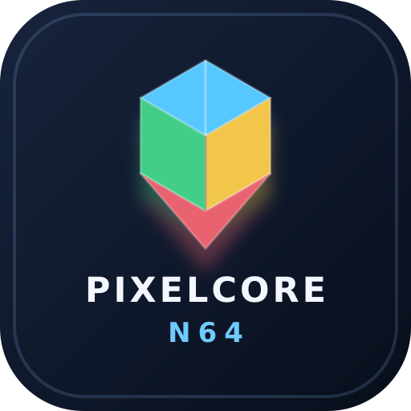

# PixelCore - N64

<p align="center">
  
</p>

<p align="center">
  A Linux desktop Nintendo 64 emulator, built as part of the PixelCore emulator family.
</p>

---

## About

**PixelCore - N64** is an open-source project to build a Nintendo 64 emulator for Linux with a friendly desktop application interface.

It is part of the **PixelCore** family of emulators, alongside PixelCore - NES.

## Project status

**Early development.** The desktop shell, ROM-header recognition, starter R4300i CPU, physical-memory bus, initial scalar RSP, VI framebuffer extraction, and a growing RDP command/rasterization path are in place. The emulator cannot run commercial games yet.

- [x] Initial Qt desktop application
- [x] ROM file picker
- [x] Recognize common N64 ROM byte orders (.z64, .v64, and .n64)
- [x] Normalize ROM byte order for the emulation core
- [x] Initial MIPS R4300i CPU core and starter instruction set
- [x] CPU arithmetic, shifts, HI/LO operations, and multiply/divide
- [x] Initial COP0 access, ERET, exception handling, and Count/Compare timer interrupts
- [x] Initial CP0 Random/Wired cycling and TLBWR replacement selection
- [x] Byte, halfword, word, doubleword, and unaligned merge memory instructions
- [x] Initial LL/SC load-linked and store-conditional support
- [x] Initial 8 MiB RDRAM, read-only cartridge/boot ROM, 64-byte PIF RAM, and 4 KiB SP DMEM/IMEM mappings
- [x] Connect the R4300i CPU to the memory bus through an initial N64 system core
- [x] Connect desktop ROM loading and normalized cartridge images to the system core
- [x] Initial PIF Joybus controller identify/reset/read command processing
- [x] Initial SI 64-byte DMA transfers between RDRAM and PIF RAM
- [x] Initial MI routing and R4300i handling for SI completion interrupts
- [x] Initial PI DMA for cartridge ROM-to-RDRAM and RDRAM-to-save-RAM transfers
- [x] Initial SP DMA between RDRAM and RSP DMEM/IMEM, including block count and skip
- [x] Initial scalar RSP core with integer arithmetic, HI/LO multiply/divide, branches, delay slots, and DMEM access
- [x] Initial SP PC, HALT, and BROKE control/status integration
- [x] Initial bounded CPU/RSP instruction scheduler using the approximate 2:3 processor clock ratio
- [x] Desktop timer runs bounded CPU/RSP batches and refreshes the VI framebuffer
- [x] Desktop can load a user-supplied IPL ROM image
- [x] Initial VI register block and RGBA5551/RGBA8888 framebuffer extraction
- [x] Connect VI framebuffer output to the Qt desktop viewport with a 60 Hz refresh timer
- [ ] Complete hardware register models (MI, SI, PI, VI timing/interrupts, AI, RI)
- [x] Initial TLB and virtual-memory translation (complete hardware edge cases remain)
- [ ] Complete RCP (RSP vector unit/COP0, full RDP pipeline integration, and accurate device scheduling)
- [ ] Audio processing
- [x] Initial keyboard-to-PIF controller input mapping (game execution not active yet)
- [ ] Save states

CPU instruction coverage is still incomplete. Arithmetic overflow exceptions, full TLB behavior, precise cycle timing, full interrupt coverage, and many coprocessor instructions are not implemented yet. The initial N64 system core owns the CPU and memory bus and can execute test instructions fetched from a mapped boot ROM. The memory bus also models the PIF's 64-byte RAM window and an early Joybus controller path supporting controller identification, reset, and button/stick reads. The initial SI DMA engine transfers the 64-byte command block between RDRAM and PIF RAM and invokes Joybus processing. Transfers are currently synchronous, but completion raises the SI interrupt through MI and the CPU can accept the external IP2 interrupt when enabled. Full asynchronous timing and other RCP interrupt sources remain unimplemented. Keyboard input is now mapped to controller 0's PIF state, but automatic game execution is now connected to the desktop timer when a user-supplied IPL ROM is loaded; commercial-game boot is still blocked by missing CIC/PIF behavior and incomplete CPU/RSP hardware. The desktop viewport polls the VI framebuffer at approximately 60 Hz and displays valid RGBA5551/RGBA8888 frames when software has configured VI registers and populated RDRAM. Accessory protocols, full controller-pak behavior, CIC handling, and authentic IPL boot remain unimplemented. The desktop ROM loader normalizes .z64, .v64, and .n64 images into canonical big-endian bytes and maps the cartridge into the system core. The initial PI path transfers cartridge data into RDRAM and RDRAM data into an in-memory 128 KiB save-RAM window, and raises the PI interrupt through MI. Save data is not yet persisted to disk. The memory bus maps the RSP's 4 KiB data and instruction memories. The initial SP DMA engine moves data between RDRAM and DMEM/IMEM, including multi-block transfers; it is synchronous. The initial scalar RSP processor executes a starter subset of integer instructions from IMEM and can access DMEM. It supports basic SP PC/HALT/BROKE control, but vector instructions, COP0, complete SP status behavior, and accurate RSP timing are not implemented. Initial SI, MI, and VI register paths are modeled. The VI can extract RGBA5551 or RGBA8888 pixels from RDRAM into an ARGB framebuffer, but scanout timing, VI interrupts, scaling, filtering, and the desktop display connection are not implemented yet; the remaining hardware devices are also incomplete. TLB translation includes mapped even/odd pages, ASID/global matching, and basic valid/dirty fault handling; additional hardware edge cases remain. LL/SC and COP0 behavior are early simplified implementations. The RDP now has an initial command decoder, texture loading/addressing/filtering, rectangle and triangle rasterization, color/depth handling, and scissor support; these are still incomplete and are not yet sufficient for commercial-game rendering. The desktop currently loads and identifies a ROM but does not automatically execute it: the CPU is reset to the boot-ROM entry point, and no authentic IPL boot ROM/CIC path is supplied. The core now supports bounded CPU instruction batches with approximate RSP scheduling, but the desktop run loop does not use it yet. The next major playability milestones are implementing a usable boot process, connecting the scheduler to the desktop run loop, completing the missing CPU/RSP and device behavior, and connecting a functional RDP display pipeline. Audio can follow after an initial game reaches gameplay. There is no reliable playability date until those milestones are implemented and tested. The automated test suite currently contains six targets covering the R4300i CPU, memory bus, system integration, ROM normalization, scalar RSP, and RDP commands. Features are checked off as they are implemented and tested.

## Dependencies

- C++20 compiler
- CMake 3.20 or newer
- Qt 6 Widgets

On Ubuntu or Debian-based Linux distributions:

```bash
sudo apt update
sudo apt install build-essential cmake qt6-base-dev
```

## Build

Clone the repository and build it:

```bash
git clone https://github.com/kaz1071/PixelCore---N64.git
cd PixelCore---N64
cmake -S . -B build -DCMAKE_BUILD_TYPE=Release
cmake --build build -j"$(nproc)"
```

Run directly from the build folder:

```bash
./build/pixelcore-n64
```

## Install

To install PixelCore - N64 for the current Linux user, with its launcher and icon:

```bash
cmake -S . -B build -DCMAKE_BUILD_TYPE=Release -DCMAKE_INSTALL_PREFIX="$HOME/.local"
cmake --build build -j"$(nproc)"
cmake --install build
```

The executable is installed to `$HOME/.local/bin/pixelcore-n64`. The desktop launcher is generated using the install prefix selected at configure time, so it does not depend on the source checkout directory, the current working directory, or a particular Linux username. The icon is installed in the standard hicolor icon theme directory.

If your desktop environment does not immediately show the launcher, log out and back in or refresh its application menu. To launch from a terminal after installation:

```bash
"$HOME/.local/bin/pixelcore-n64"
```

## ROM files

The application currently recognizes the standard N64 ROM byte-order signatures:

| Format | Byte order |
| --- | --- |
| .z64 | Big-endian |
| .v64 | Byte-swapped |
| .n64 | Little-endian |

ROM selection validates the header, normalizes the complete image to canonical big-endian byte order, and maps it into the system's cartridge region. This is not yet sufficient to boot a commercial game: the PIF boot ROM, hardware initialization, TLB, RCP, and graphics pipeline are still missing.

PixelCore - N64 does not include commercial game ROMs. Use game files that you are legally entitled to use.

## Contributing

The project is in its early stages. Bug reports, ideas, and contributions are welcome as the codebase takes shape.

## License

The project license has not been selected yet.
